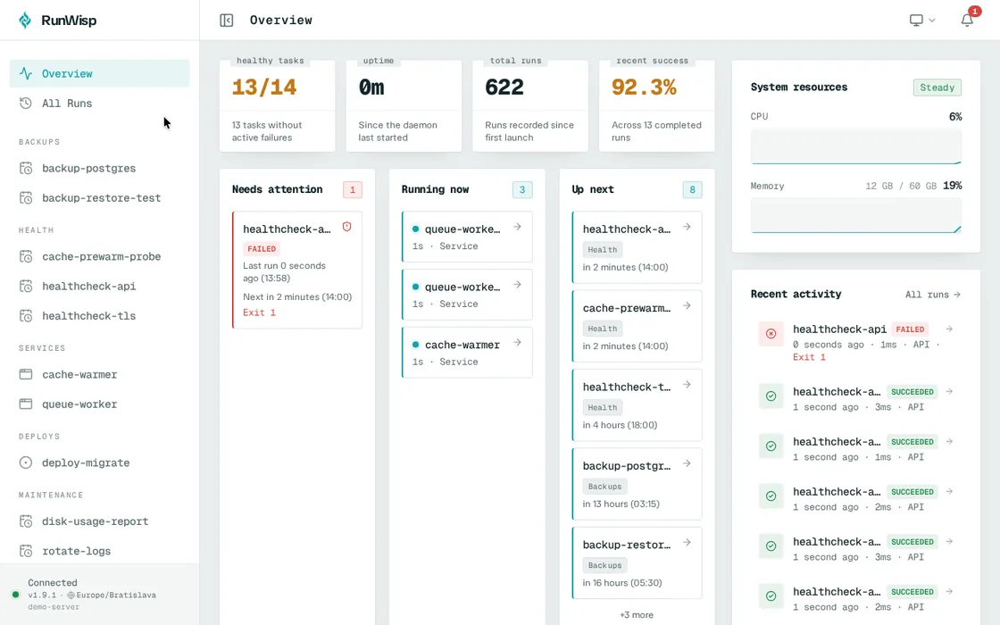

<div align="center">


# RunWisp

**Sieh, was lief, wann, warum es fehlschlug und was es ausgegeben hat.**

RunWisp ist ein quelloffener, selbst gehosteter Cronjob-Manager und Prozess-Supervisor. Er kommt als einzelnes Go-Binary mit eingebautem Web-Dashboard, Terminal-UI und REST-API.

[runwisp.com](https://runwisp.com) · [Dokumentation](https://docs.runwisp.com) · [Installation](#installation) · [Schnellstart](#schnellstart) · [Vergleich](#vergleich)

[English](README.md) · **Deutsch** · [简体中文](README.zh-CN.md)

[](LICENSE)
[](https://runwisp.com/releases/)
[](https://github.com/avelino/awesome-go)
[](https://app.codecov.io/gh/runwisp/runwisp)
[](https://sonarcloud.io/summary/new_code?id=runwisp_runwisp)
[](https://github.com/runwisp/runwisp)

</div>

---

RunWisp ersetzt `crond` und `supervisord`, wenn du geplante Jobs und langlaufende Dienste an einem Ort haben willst. Du beschreibst beides in `runwisp.toml`; der Daemon führt sie mit etwa 30 MB RAM aus, ohne Python, Node.js oder eine externe Datenbank zu brauchen.

> Erst mal reinschauen? Mit `bunx runwisp demo` probierst du RunWisp mit Demodaten aus, ganz ohne Konfiguration.

Jeder Lauf hinterlässt Spuren: Exit-Code, Dauer, Zeitstempel und stdout/stderr. Du kannst den Verlauf ansehen, Logs live verfolgen und Tasks über das Web-Dashboard, die Terminal-UI oder die REST-API starten und stoppen. Die Task-Definitionen bleiben als TOML auf der Platte.

<div align="center">

<p><em>Starte einen Lauf, verfolge seine Ausgabe und untersuche Fehler im eingebauten Dashboard.</em></p>
</div>

## Installation

```bash
curl -fsSL https://get.runwisp.com | sh
```

Oder wähle eine andere Option:

| 🍺<br>[Homebrew](https://runwisp.com/releases/?utm_source=github&utm_medium=readme-de&utm_content=homebrew) | 🐧<br>[Debian / Ubuntu](https://runwisp.com/releases/?utm_source=github&utm_medium=readme-de&utm_content=deb) | 🎩<br>[Fedora / RHEL](https://runwisp.com/releases/?utm_source=github&utm_medium=readme-de&utm_content=rpm) | 📦<br>[npm / Bun](https://runwisp.com/releases/?utm_source=github&utm_medium=readme-de&utm_content=npm) | 🐳<br>[Docker](https://runwisp.com/releases/?utm_source=github&utm_medium=readme-de&utm_content=docker) | 🗜️<br>[Tarball](https://runwisp.com/releases/?utm_source=github&utm_medium=readme-de&utm_content=tarball) |
| :---------------------------------------------------------------------------------------------------------: | :-----------------------------------------------------------------------------------------------------------: | :---------------------------------------------------------------------------------------------------------: | :-----------------------------------------------------------------------------------------------------: | :-----------------------------------------------------------------------------------------------------: | :-------------------------------------------------------------------------------------------------------: |

Wie du RunWisp aus dem Quellcode baust, steht unter [Getting started](CONTRIBUTING.md#getting-started) im Contributing-Guide.

<div align="center">

<p><em>Mit der Terminal-UI hast du Task-Status, Logs, Verlauf und Steuerung direkt in der SSH-Sitzung.</em></p>
</div>

## Schnellstart

1. Starte RunWisp in dem Verzeichnis, in dem deine Konfiguration liegen soll:

   ```bash
   runwisp
   ```

   Gibt es noch keine `runwisp.toml`, bietet RunWisp an, eine anzulegen. Drück `Enter`, dann schreibt es einen Beispiel-Task, startet den Daemon im Hintergrund und öffnet die Terminal-UI.

2. Führe den Beispiel-Task aus. Wähle `hello` in der Seitenleiste und drück `r`.

   Die Ausgabe wird live gestreamt, und der Lauf bleibt mit Exit-Code, Dauer und allem, was er ausgegeben hat, im Verlauf.

3. Öffne das Web-Dashboard. Wähle auf der Home-Seite der Terminal-UI „Open Web UI“ und drück `Enter`. Dein Browser öffnet `http://localhost:9477`, und du bist bereits angemeldet.

4. Ersetze das Beispiel in `runwisp.toml` durch deine eigenen Jobs und Dienste:

   ```toml
   [tasks.backup-db]
   cron       = "0 2 * * *"
   jitter     = "30m"  # may start up to 30m late while other jittered jobs run
   on_overlap = "kill" # if yesterday's job is still running, kill it
   keep_runs  = 30     # keep the last 30 runs in the history
   run        = "pg_dump mydb | gzip > /backups/mydb-$(date +%F).sql.gz"

   [services.worker]
   instances    = 3                           # keep three copies running
   env          = { NODE_ENV = "production" } # shown in API/UI
   secrets_file = "/etc/runwisp/worker.env"   # values never shown in API/UI
   run          = "node /app/worker.js"
   ```

5. Übernimm die Änderung und probiere den Job aus, ohne bis 02:00 Uhr zu warten:

   ```bash
   runwisp validate        # check the file, start nothing
   runwisp reload          # apply it; a file with an error is rejected and nothing changes
   runwisp run backup-db   # run it now
   runwisp logs backup-db  # what the last run printed
   ```

6. Lass RunWisp nach einem Neustart automatisch starten, unter systemd oder launchd:

   ```bash
   runwisp service install        # on macOS: runwisp service install --local
   ```

Die Home-Seite zeigt außerdem ein generiertes Passwort, mit dem du dich aus einem anderen Browser anmelden kannst. Setz `RUNWISP_PASSWORD`, um es selbst zu wählen. Setzt du zusätzlich `RUNWISP_VIEWER_PASSWORD`, kann jeder, der sich damit anmeldet, [alles sehen, aber nichts ändern](https://docs.runwisp.com/operations/auth/#read-only-access). Für ein vertrauenswürdiges lokales Setup schaltet [`RUNWISP_AUTH=off`](https://docs.runwisp.com/operations/auth/#running-without-a-password) die Authentifizierung ausdrücklich ab.

> **Ohne Terminal?** Nutze `runwisp daemon` in cron, systemd, Docker, CI oder einer SSH-Sitzung mit Pipe. Es stellt keine Rückfragen, und wenn die Konfiguration fehlt, beendet es sich mit einem Exit-Code ungleich null.

Weiter geht es mit [deinem ersten Task](https://docs.runwisp.com/getting-started/first-task/), [deinem ersten Dienst](https://docs.runwisp.com/getting-started/first-service/) und [Timeouts, Wiederholungen und Fehleralarmen](https://docs.runwisp.com/getting-started/failures/) (auf Englisch).

## Umstieg von cron, supervisord oder Docker Compose

RunWisp kann mit der Konfiguration starten, die du schon hast:

- [Von cron übernehmen](https://docs.runwisp.com/coming-from/cron/).
- [Crontab importieren](https://docs.runwisp.com/coming-from/cron/#convert-by-hand).
- [Supervisord importieren](https://docs.runwisp.com/coming-from/supervisord/)
- [Docker Compose importieren](https://docs.runwisp.com/coming-from/docker-compose/).
- [node-cron durch `@runwisp/js` ersetzen](https://docs.runwisp.com/coming-from/node-cron/).
- [Den Laravel-, Symfony- oder CodeIgniter-Scheduler mit `runwisp/runwisp` ausführen](https://docs.runwisp.com/sdk/php/).

## Funktionen

**Planung und Überwachung**

- Standard-Cron-Zeitpläne, Umgang mit verpassten Läufen, Wiederholungen, Timeouts und die Überlappungsregeln `queue`, `skip` oder `kill`
- Langlaufende Dienste mit mehreren Instanzen, Restart-Backoff, Absturz-Wiederherstellung und sauberem Herunterfahren. 500.000 Zeilen pro Tag, monatelang ohne Unterbrechung: RunWisp schafft das und streamt es dir.
- Typisierte Parameter für manuelle Läufe, übergeben als Argumente oder Umgebungsvariablen über UI/API/CLI

**Laufverlauf und Logs**

- Exit-Code, Dauer, Zeitstempel und Status dauerhaft im eingebetteten SQLite gespeichert
- Live-Streaming von stdout/stderr in Web-UI und Terminal-UI
- Log-Rotation pro Task und Fehlerbenachrichtigungen über Slack, Discord, Telegram, ntfy, Gotify, Pushover, E-Mail, Webhooks oder den In-App-Posteingang

**Täglicher Betrieb**

- Ein Binary, in das das Svelte-Web-Dashboard und SQLite eingebettet sind
- TOML-Konfiguration, die sich wie Code versionieren und reviewen lässt
- Reloads mit vorheriger Validierung, wiederherstellbarer Zustand nach Absturz oder Stromausfall und Meldung unterbrochener Läufe beim Neustart
- Local-first-Betrieb ohne Registrierung, Konto oder Pflicht-Netzwerkverbindung. Der einzige ausgehende Aufruf ist standardmäßig eine anonyme Update-Prüfung, abschaltbar mit [`check_updates = false`](https://docs.runwisp.com/configuration/daemon/#check_updates)

## Vergleich

|                        | crond   | systemd-Timer      | supervisord    | **RunWisp**                                                           |
| ---------------------- | ------- | ------------------ | -------------- | --------------------------------------------------------------------- |
| Cron-Planung           | Ja      | Ja                 | Nein           | **Ja**                                                                |
| Prozessüberwachung     | Nein    | Ja                 | Ja             | **Ja**                                                                |
| Web-Dashboard          | Nein    | Nein               | Einfaches HTML | **Eingebaut**                                                         |
| Terminal-UI            | Nein    | Nein               | Nein           | **Eingebaut**                                                         |
| Fernschnittstelle      | Nein    | D-Bus              | XML-RPC        | **REST-API**                                                          |
| Live-Log-Streaming     | Nein    | `journalctl -f`    | Nur tail       | **Web-UI, TUI und SSE**                                               |
| Nebenläufigkeitsregeln | Nein    | Überlappungsschutz | Nein           | **Queue, skip oder kill**                                             |
| Fehleralarme           | Nein    | `OnFailure=`-Unit  | Event-Listener | **Slack, Discord, Telegram, ntfy, Gotify, Pushover, E-Mail, Webhook** |
| Ausführungsverlauf     | Nein    | `journalctl`       | Nein           | **SQLite, in der UI einsehbar**                                       |
| Laufzeitabhängigkeiten | libc    | systemd            | Python         | **Keine**                                                             |
| Konfiguration          | crontab | Unit-Dateien       | INI-Dateien    | **Eine TOML-Datei**                                                   |

API und Oberflächen können Tasks ansehen sowie starten und stoppen. **Task-Definitionen lassen sich nicht aus der Ferne ändern.** `runwisp.toml` bleibt die einzige Quelle der Wahrheit.

## Links

- [Dokumentation](https://docs.runwisp.com) zu Installation, Konfiguration, REST-API und Betrieb (auf Englisch)
- [Changelog](CHANGELOG.md) mit den Änderungen jeder Version
- [Contributing](CONTRIBUTING.md), wenn du RunWisp aus dem Quellcode bauen oder einen PR schicken willst
- [Sicherheitsrichtlinie](SECURITY.md), wenn du eine Sicherheitslücke gefunden hast
- [Issue-Tracker](https://github.com/runwisp/runwisp/issues) für Fehlerberichte und Feature-Wünsche

## Wie RunWisp entsteht

RunWisp wird von PoppyCake, s.r.o. entwickelt. Wir setzen stark auf Review und Tests. Das Review geht bis ins Kleine, etwa ob ein Helper existieren sollte oder einfach drei Zeilen inline sein könnte, denn so bleibt der Code klein und schnell lesbar. Der Daemon hat mehr Testzeilen als Code, inklusive kniffliger Fälle wie eines täglichen Jobs, der in genau der Stunde geplant ist, die die Sommerzeitumstellung überspringt.

Sorgfältiges Review und gute Tests sind trotzdem keine Garantie. Wenn wir etwas übersehen haben, [öffne ein Issue](https://github.com/runwisp/runwisp/issues), und wir beheben es.

_Richard Popelis, Lead Developer_

## Lizenz

Der RunWisp-Daemon und die Web-UI stehen unter GPL-3.0-or-later. Kurz gesagt: Mach damit, was du willst, aber wenn du eine veränderte Version verbreitest, muss sie unter derselben Lizenz offen bleiben. Siehe [LICENSE](LICENSE).

Die gemeinsamen Bibliotheken unter `packages/`, das Konfigurations-JSON-Schema und die OpenAPI-Beschreibung stehen stattdessen unter Apache-2.0. Siehe [LICENSE-APACHE](LICENSE-APACHE) und die Lizenzdatei im jeweiligen Paket.

---

<div align="center">

[runwisp.com](https://runwisp.com) · [Dokumentation](https://docs.runwisp.com) · [Releases](https://runwisp.com/releases/) · [Fehler melden](https://github.com/runwisp/runwisp/issues)

</div>
