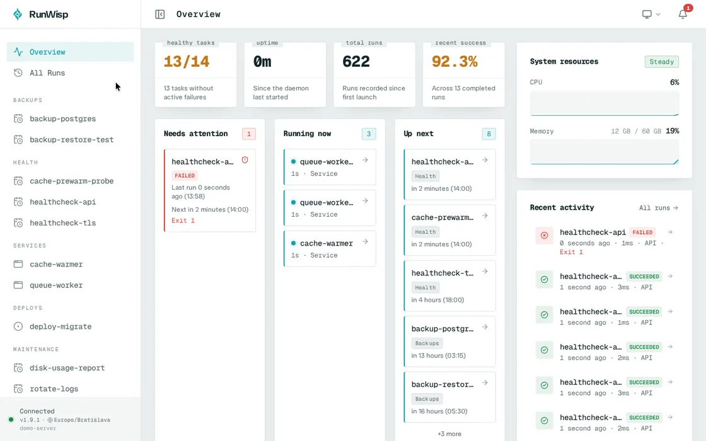

<div align="center">


# RunWisp

**See what ran, when, why it failed, and what it printed.**

RunWisp is an open-source, self-hosted cron job manager and process supervisor. It ships as a single Go binary with a built-in web dashboard, terminal UI, and REST API.

[runwisp.com](https://runwisp.com) · [Documentation](https://docs.runwisp.com) · [Install](#install) · [Quick Start](#quick-start) · [Compare](#comparison)

**English** · [Deutsch](README.de.md) · [简体中文](README.zh-CN.md)

[](LICENSE)
[](https://runwisp.com/releases/)
[](https://github.com/avelino/awesome-go)
[](https://app.codecov.io/gh/runwisp/runwisp)
[](https://sonarcloud.io/summary/new_code?id=runwisp_runwisp)
[](https://github.com/runwisp/runwisp)

</div>

---

RunWisp replaces `crond` and `supervisord` when you want scheduled jobs and long-running services in one place. You describe both in `runwisp.toml`; the daemon runs them in about 30 MB of RAM, without needing Python, Node.js or an external database.

> Want a look first? Run `bunx runwisp demo` to try RunWisp with demo data and nothing to configure.

Every run leaves evidence behind: its exit code, duration, timestamps, and stdout/stderr. You can inspect history, follow logs, and trigger or stop tasks from the web dashboard, terminal UI, or REST API. Task definitions stay on disk in TOML.

<div align="center">

<p><em>Trigger a run, follow its output, and inspect failures from the built-in dashboard.</em></p>
</div>

## Install

```bash
curl -fsSL https://get.runwisp.com | sh
```

Or pick another option:

| 🍺<br>[Homebrew](https://runwisp.com/releases/?utm_source=github&utm_medium=readme&utm_content=homebrew) | 🐧<br>[Debian / Ubuntu](https://runwisp.com/releases/?utm_source=github&utm_medium=readme&utm_content=deb) | 🎩<br>[Fedora / RHEL](https://runwisp.com/releases/?utm_source=github&utm_medium=readme&utm_content=rpm) | 📦<br>[npm / Bun](https://runwisp.com/releases/?utm_source=github&utm_medium=readme&utm_content=npm) | 🐳<br>[Docker](https://runwisp.com/releases/?utm_source=github&utm_medium=readme&utm_content=docker) | 🗜️<br>[Tarball](https://runwisp.com/releases/?utm_source=github&utm_medium=readme&utm_content=tarball) |
| :------------------------------------------------------------------------------------------------------: | :--------------------------------------------------------------------------------------------------------: | :------------------------------------------------------------------------------------------------------: | :--------------------------------------------------------------------------------------------------: | :--------------------------------------------------------------------------------------------------: | :----------------------------------------------------------------------------------------------------: |

To build from source, see [Getting started](CONTRIBUTING.md#getting-started) in the contributing guide.

<div align="center">

<p><em>The terminal UI keeps task status, logs, history, and controls in the SSH session.</em></p>
</div>

## Quick Start

1. Start RunWisp in the directory where your config should live:

   ```bash
   runwisp
   ```

   If there is no `runwisp.toml` yet, RunWisp offers to create one. Press `Enter` and it writes an example task, starts the daemon in the background, and opens the terminal UI.

2. Run the example task. Select `hello` in the sidebar and press `r`.

   The output streams live, and the run stays in the history with its exit code, duration, and everything it printed.

3. Open the web dashboard. On the Home page of the terminal UI, select "Open Web UI" and press `Enter`. Your browser opens `http://localhost:9477`, already logged in.

4. Replace the example with your own jobs and services in `runwisp.toml`:

   ```toml
   [tasks.backup-db]
   cron       = "0 2 * * *"
   jitter     = "30m"  # may start up to 30m late while other jittered jobs run
   on_overlap = "kill" # if yesterday's job is still running, kill it
   keep_runs  = 30     # keep the last 30 runs in the history
   run        = "pg_dump mydb | gzip > /backups/mydb-$(date +%F).sql.gz"

   [services.worker]
   instances    = 3                           # keep three copies running
   env          = { NODE_ENV = "production" } # shown in API/UI
   secrets_file = "/etc/runwisp/worker.env"   # values never shown in API/UI
   run          = "node /app/worker.js"
   ```

5. Apply the change, then try the job without waiting for 02:00:

   ```bash
   runwisp validate        # check the file, start nothing
   runwisp reload          # apply it; a file with an error is rejected and nothing changes
   runwisp run backup-db   # run it now
   runwisp logs backup-db  # what the last run printed
   ```

6. Start RunWisp after a reboot, under systemd or launchd:

   ```bash
   runwisp service install        # on macOS: runwisp service install --local
   ```

The Home page also shows a generated password for signing in from another browser. Set `RUNWISP_PASSWORD` to choose it yourself. Set `RUNWISP_VIEWER_PASSWORD` too and anyone who signs in with it can [view everything but change nothing](https://docs.runwisp.com/operations/auth/#read-only-access). For a trusted local setup, [`RUNWISP_AUTH=off`](https://docs.runwisp.com/operations/auth/#running-without-a-password) disables authentication explicitly.

> **Running headless?** Use `runwisp daemon` in cron, systemd, Docker, CI, or a piped SSH session. It doesn't prompt, and a missing config exits non-zero.

Next: [your first task](https://docs.runwisp.com/getting-started/first-task/), [your first service](https://docs.runwisp.com/getting-started/first-service/), and [timeouts, retries, and failure alerts](https://docs.runwisp.com/getting-started/failures/).

## Moving from cron, supervisord, or Docker Compose

RunWisp can start from the configuration you already have:

- [Take over from cron](https://docs.runwisp.com/coming-from/cron/).
- [Import crontab](https://docs.runwisp.com/coming-from/cron/#convert-by-hand).
- [Import supervisord](https://docs.runwisp.com/coming-from/supervisord/)
- [Import docker compose](https://docs.runwisp.com/coming-from/docker-compose/).
- [Swap node-cron for `@runwisp/js`](https://docs.runwisp.com/coming-from/node-cron/).
- [Run your Laravel, Symfony, or CodeIgniter schedule with `runwisp/runwisp`](https://docs.runwisp.com/sdk/php/).

## Features

**Scheduling and supervision**

- Standard cron schedules, missed-run handling, retries, timeouts, and `queue`, `skip`, or `kill` overlap policies
- Long-running services with multiple instances, restart backoff, crash recovery, and graceful shutdown. 500k lines/day, for months without interruption, RunWisp can handle it and stream it to you.
- Typed parameters for manual runs, passed as arguments or environment variables through UI/API/CLI

**Run history and logs**

- Exit code, duration, timestamps, and status persisted in embedded SQLite
- Live stdout/stderr streaming in the web UI and terminal UI
- Per-task log rotation and failure notifications through Slack, Discord, Telegram, ntfy, Gotify, Pushover, email, webhooks, or the in-app inbox

**Day-to-day operation**

- One binary with the Svelte web dashboard and SQLite embedded
- TOML configuration that can be versioned and reviewed like code
- Validate-first reloads, recoverable state after a crash or power loss, and interrupted-run reporting on restart
- Local-first operation with no signup, account, or required network connection. The only outbound call by default is an anonymous update check, turned off with [`check_updates = false`](https://docs.runwisp.com/configuration/daemon/#check_updates)

## Comparison

|                      | crond   | systemd timers     | supervisord    | **RunWisp**                                                          |
| -------------------- | ------- | ------------------ | -------------- | -------------------------------------------------------------------- |
| Cron scheduling      | Yes     | Yes                | No             | **Yes**                                                              |
| Process supervision  | No      | Yes                | Yes            | **Yes**                                                              |
| Web dashboard        | No      | No                 | Basic HTML     | **Built in**                                                         |
| Terminal UI          | No      | No                 | No             | **Built in**                                                         |
| Remote interface     | No      | D-Bus              | XML-RPC        | **REST API**                                                         |
| Live log streaming   | No      | `journalctl -f`    | Tail only      | **Web UI, TUI, and SSE**                                             |
| Concurrency policies | No      | Overlap prevention | No             | **Queue, skip, or kill**                                             |
| Failure alerts       | No      | `OnFailure=` unit  | Event listener | **Slack, Discord, Telegram, ntfy, Gotify, Pushover, email, webhook** |
| Execution history    | No      | `journalctl`       | No             | **SQLite, browsable in the UI**                                      |
| Runtime dependencies | libc    | systemd            | Python         | **None**                                                             |
| Configuration        | crontab | Unit files         | INI files      | **One TOML file**                                                    |

The API and user interfaces can inspect tasks and trigger or stop them. **Task definitions cannot be modified remotely.** `runwisp.toml` remains the source of truth.

## Links

- [Documentation](https://docs.runwisp.com) for installation, configuration, the REST API and operations
- [Changelog](CHANGELOG.md) for what changed in each version
- [Contributing](CONTRIBUTING.md) if you want to build it from source or send a PR
- [Security policy](SECURITY.md) if you found a vulnerability
- [Issue tracker](https://github.com/runwisp/runwisp/issues) for bugs and feature requests

## How RunWisp is made

RunWisp is built by PoppyCake, s.r.o. We lean hard on review and tests. Review goes down to the small stuff, like whether a helper deserves to exist or should just be three lines inline, because that's how the code stays small and quick to read. The daemon has more lines of tests than code, including awkward cases like a daily job scheduled inside the hour that daylight saving skips.

Careful review and good tests still aren't a guarantee. If we missed something, [open an issue](https://github.com/runwisp/runwisp/issues) and we'll fix it.

_Richard Popelis, lead developer_

## License

The RunWisp daemon and web UI are licensed under GPL-3.0-or-later. Basically, do what you want but if you distribute a modified version, you must keep it open under the same license. See [LICENSE](LICENSE).

Shared libraries under `packages/`, the config JSON Schema and the OpenAPI description use Apache-2.0 instead. See [LICENSE-APACHE](LICENSE-APACHE) and the license file in each package.

---

<div align="center">

[runwisp.com](https://runwisp.com) · [Documentation](https://docs.runwisp.com) · [Releases](https://runwisp.com/releases/) · [Report a bug](https://github.com/runwisp/runwisp/issues)

</div>
