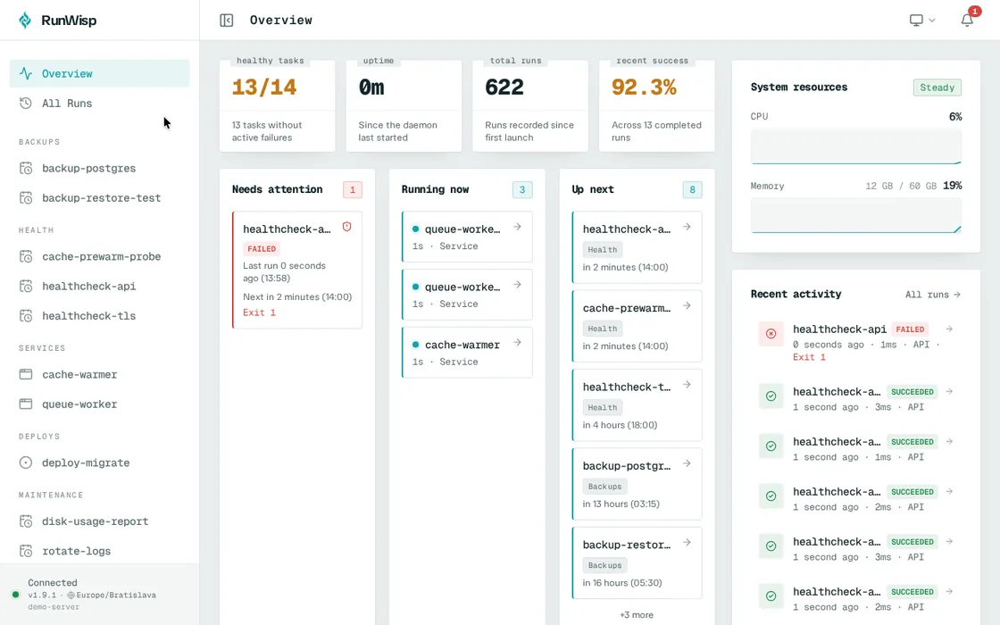

<div align="center">


# RunWisp

**看清运行了什么、何时运行、为什么失败，以及输出了什么。**

RunWisp 是一个开源、自托管的 cron 任务管理器和进程守护工具。它以单个 Go 二进制文件发布，内置 Web 控制台、终端界面和 REST API。

[runwisp.com](https://runwisp.com) · [文档](https://docs.runwisp.com) · [安装](#安装) · [快速开始](#快速开始) · [对比](#对比)

[English](README.md) · [Deutsch](README.de.md) · **简体中文**

[](LICENSE)
[](https://runwisp.com/releases/)
[](https://github.com/avelino/awesome-go)
[](https://app.codecov.io/gh/runwisp/runwisp)
[](https://sonarcloud.io/summary/new_code?id=runwisp_runwisp)
[](https://github.com/runwisp/runwisp)

</div>

---

当你想把定时任务和常驻服务放在一处管理时，RunWisp 可以替代 `crond` 和 `supervisord`。两者都写在 `runwisp.toml` 里；守护进程负责运行它们，不需要 Python、Node.js 或外部数据库。

> 想先看看？运行 `bunx runwisp demo`，用演示数据体验 RunWisp，无需任何配置。

每次运行都会留下记录：退出码、耗时、时间戳以及 stdout/stderr。你可以在 Web 控制台、终端界面或 REST API 中查看历史、实时跟踪日志、触发或停止任务。任务定义始终以 TOML 形式保存在磁盘上。

<div align="center">

<p><em>在内置控制台中触发运行、跟踪输出并排查失败。</em></p>
</div>

## 安装

将最新的二进制文件安装到 `PATH`：

```bash
curl -fsSL https://get.runwisp.com | sh
```

在 macOS 或 Linux 上使用 [Homebrew](https://brew.sh)：

```bash
brew install runwisp/tap/runwisp
```

在 Debian、Ubuntu、Fedora 或 RHEL 上安装软件包。它会添加 RunWisp 软件源，之后 `apt upgrade` 或 `dnf upgrade` 即可保持更新：

```bash
curl -fLO https://github.com/runwisp/runwisp/releases/latest/download/runwisp-linux-x64.deb
sudo apt install ./runwisp-linux-x64.deb
# 或
sudo dnf install https://github.com/runwisp/runwisp/releases/latest/download/runwisp-linux-x64.rpm
```

也可以使用 npm 包，它会运行预编译的 Go 二进制文件：

```bash
bunx runwisp
bun add -g runwisp     # 或：npm install -g runwisp
```

压缩包可从 [runwisp.com/releases](https://runwisp.com/releases/) 下载。使用 Docker：

```bash
docker run -d --name runwisp -p 9477:9477 \
  -e RUNWISP_PASSWORD=change-me \
  -v ./runwisp:/etc/runwisp \
  -v runwisp-data:/var/lib/runwisp \
  runwisp/runwisp:latest
```

首次启动时，RunWisp 会在 `./runwisp/runwisp.toml` 写入一份初始配置。镜像支持 amd64 和 arm64，提供 Alpine 和 Debian 两种变体。标签、环境变量和卷的说明见 [Docker 指南](https://docs.runwisp.com/getting-started/docker/)。

从源码构建请参阅贡献指南中的 [Getting started](CONTRIBUTING.md#getting-started)。

## 快速开始

运行：

```bash
runwisp
```

如果当前目录没有 `runwisp.toml`，RunWisp 会提示创建一份示例配置。按 `Enter`，它会写入一个示例任务、启动守护进程并打开终端界面。首页会显示 Web 控制台的地址和自动生成的密码；在密码那一行按 `Enter` 即可复制。

如果想自己设定密码，请设置环境变量 `RUNWISP_PASSWORD`。再设置 `RUNWISP_VIEWER_PASSWORD` 后，用它登录的人可以[查看所有内容但无法修改](https://docs.runwisp.com/operations/auth/#read-only-access)。在可信的本地环境中，可以用 [`RUNWISP_AUTH=off`](https://docs.runwisp.com/operations/auth/#running-without-a-password) 明确关闭身份验证。

> **无终端运行？** 在 cron、systemd、Docker、CI 或管道化的 SSH 会话中使用 `runwisp daemon`。它不会弹出提示，缺少配置时以非零状态退出。要让 RunWisp 在重启后自动启动，请使用 `runwisp service install`（支持 systemd 和 launchd）。

把初始任务替换成你自己的任务和服务：

```toml
[tasks.backup-db]
cron       = "0 2 * * *"
jitter     = "30m"  # delay by up to 30 mins if other jobs are running
on_overlap = "kill" # if yesterday's job is still running, kill it
keep_runs  = 30     # remove older runs
run = "pg_dump mydb | gzip > /backups/mydb-$(date +%F).sql.gz"

[services.worker]
instances    = 3                           # keep three copies running
env          = { NODE_ENV = "production" } # shown in API/UI
secrets_file = "/etc/runwisp/worker.env"   # never leaked to the API/UI
run          = "node /app/worker.js"
```

## 从 cron、supervisord 或 Docker Compose 迁移

RunWisp 可以直接沿用你现有的配置：

- [从 cron 接管](https://docs.runwisp.com/coming-from/cron/)。
- [导入 crontab](https://docs.runwisp.com/coming-from/cron/#convert-by-hand)。
- [导入 supervisord](https://docs.runwisp.com/coming-from/supervisord/)。
- [导入 Docker Compose](https://docs.runwisp.com/coming-from/docker-compose/)。
- [用 `@runwisp/js` 替换 node-cron](https://docs.runwisp.com/coming-from/node-cron/)。

<div align="center">

<p><em>终端界面让你在 SSH 会话中掌握任务状态、日志、历史和控制。</em></p>
</div>

## 功能

**调度与守护**

- 标准 cron 调度、错过运行的处理、重试、超时，以及 `queue`、`skip`、`kill` 三种重叠策略
- 常驻服务支持多实例、重启退避、崩溃恢复和优雅关闭。每天 50 万行输出、连续数月不间断，RunWisp 都能承受并实时推送给你。
- 手动运行时可传入带类型的参数，通过 UI/API/CLI 以命令行参数或环境变量的形式传递

**运行历史与日志**

- 退出码、耗时、时间戳和状态持久化在内嵌的 SQLite 中
- 在 Web 界面和终端界面中实时查看 stdout/stderr
- 按任务的日志轮转，以及通过 Slack、Discord、Telegram、ntfy、Gotify、Pushover、电子邮件、Webhook 或应用内收件箱发送失败通知

**日常运维**

- 单个二进制文件，内嵌 Svelte Web 控制台和 SQLite
- TOML 配置，可以像代码一样做版本管理和评审
- 先校验再生效的重载、崩溃或断电后可恢复的状态，以及重启时报告被中断的运行
- 本地优先，无需注册、账号或必需的网络连接。默认唯一的出站请求是匿名的更新检查，可用 [`check_updates = false`](https://docs.runwisp.com/configuration/daemon/#check_updates) 关闭

## 对比

|            | crond   | systemd timers    | supervisord | **RunWisp**                                                             |
| ---------- | ------- | ----------------- | ----------- | ----------------------------------------------------------------------- |
| Cron 调度  | 是      | 是                | 否          | **是**                                                                  |
| 进程守护   | 否      | 是                | 是          | **是**                                                                  |
| Web 控制台 | 否      | 否                | 简单 HTML   | **内置**                                                                |
| 终端界面   | 否      | 否                | 否          | **内置**                                                                |
| 远程接口   | 否      | D-Bus             | XML-RPC     | **REST API**                                                            |
| 实时日志流 | 否      | `journalctl -f`   | 仅 tail     | **Web 界面、TUI 和 SSE**                                                |
| 并发策略   | 否      | 防止重叠          | 否          | **排队、跳过或终止**                                                    |
| 失败告警   | 否      | `OnFailure=` 单元 | 事件监听器  | **Slack、Discord、Telegram、ntfy、Gotify、Pushover、电子邮件、Webhook** |
| 执行历史   | 否      | `journalctl`      | 否          | **SQLite，可在界面中浏览**                                              |
| 运行时依赖 | libc    | systemd           | Python      | **无**                                                                  |
| 配置方式   | crontab | Unit 文件         | INI 文件    | **一个 TOML 文件**                                                      |

API 和用户界面可以查看任务、触发或停止任务。**任务定义无法远程修改。** `runwisp.toml` 始终是唯一的事实来源。

## 链接

- [文档](https://docs.runwisp.com)：安装、配置、REST API 和运维（英文）
- [更新日志](CHANGELOG.md)：近期变更和版本历史
- [贡献指南](CONTRIBUTING.md)：开发环境搭建和贡献规范
- [安全策略](SECURITY.md)：负责任的漏洞披露
- [问题追踪](https://github.com/runwisp/runwisp/issues)：错误报告和功能建议

## RunWisp 是如何做出来的

RunWisp 由 PoppyCake, s.r.o. 开发。我们非常依赖代码评审和测试。评审细致到小处，比如某个辅助函数是否值得存在、还是直接内联三行就好，这样代码才能保持精简、易读。守护进程的测试代码行数比业务代码还多，其中包括一些棘手的情况，比如某个每日任务恰好被安排在夏令时跳过的那一小时里。

即便评审仔细、测试充分，也不能保证万无一失。如果我们漏掉了什么，请[提交 issue](https://github.com/runwisp/runwisp/issues)，我们会修复。

_Richard Popelis，首席开发者_

## 许可证

RunWisp 守护进程和 Web 界面采用 GPL-3.0-or-later 许可证。简单来说，你可以随意使用，但如果分发修改后的版本，必须以相同许可证保持开源。详见 [LICENSE](LICENSE)。

`packages/` 下的共享库、配置 JSON Schema 和 OpenAPI 描述则采用 Apache-2.0 许可证。详见 [LICENSE-APACHE](LICENSE-APACHE) 以及各个包中的许可证文件。

---

<div align="center">

[runwisp.com](https://runwisp.com) · [文档](https://docs.runwisp.com) · [版本发布](https://runwisp.com/releases/) · [报告问题](https://github.com/runwisp/runwisp/issues)

</div>
