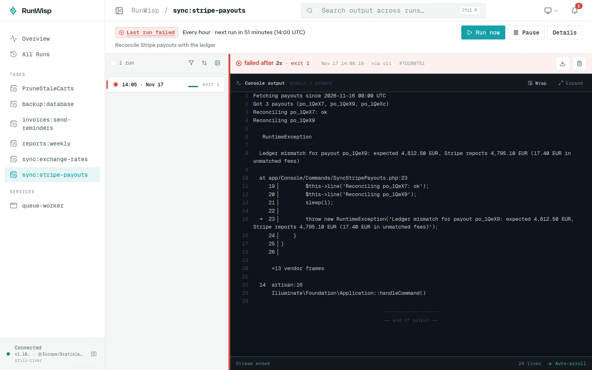

# runwisp/runwisp

Run your Laravel schedule and queue worker under
[RunWisp](https://github.com/runwisp/runwisp), and see every run in a web UI:
its output, exit code and duration. Symfony, CodeIgniter 4 and plain PHP work
too.



## Laravel

```bash
composer require runwisp/runwisp
php artisan runwisp:work
```

`runwisp:work` replaces the `schedule:run` cron entry. Your schedule stays as it
is.

- A run that throws fails, with the stack trace in its log.
- Runs that `when()`, `between()`, maintenance mode or `withoutOverlapping()`
  skipped show as skipped, not as succeeded.
- Your [queue worker](https://docs.runwisp.com/sdk/php/laravel/#queue-workers)
  can run under it too, restarted when it exits.
- `php artisan runwisp:check` lists the tasks with their next runs and
  validates the config, so CI catches a mistake before a deploy.
  `runwisp:reload` picks up the new schedule after one.
- `#[RunWisp\Task(retry_attempts: 3)]` on a command, job or closure adds
  RunWisp keys to its task.

Laravel 11, 12 and 13. Read the
[Laravel guide](https://docs.runwisp.com/sdk/php/laravel/).

## Symfony and CodeIgniter 4

`bin/console runwisp:work` runs the Scheduler component's schedules, and
`php spark runwisp:work` runs `codeigniter4/tasks`. Both have `runwisp:check`.

## Plain PHP

```php
<?php
// runwisp.php
require __DIR__ . '/vendor/autoload.php';

$runwisp = new RunWisp\RunWisp();

$runwisp->task('nightly-backup', ['cron' => '0 3 * * *', 'retry_attempts' => 3], function (RunWisp\Run $run) {
    echo "dumping the database\n";
});

exit($runwisp->main());
```

```
$ php runwisp.php
RunWisp dashboard: http://127.0.0.1:9477, get the password with: vendor/bin/runwisp password --data .runwisp
```

- Each run is a new PHP process, so runs happen at the same time and a stop
  from the web UI really stops one.
- Runs once per data directory, however many copies of the worker run.
- Retries, jitter, timeouts and notifications are task options.
- `php runwisp.php check` validates the config and exits with 1 on a mistake.

Linux, macOS and WSL, PHP 8.2 or later. The Composer plugin downloads the
`runwisp` binary of the same version. Read the
[PHP SDK guide](https://docs.runwisp.com/sdk/php/) for every option.

Issues and stars go to [runwisp/runwisp](https://github.com/runwisp/runwisp).
This package is Apache-2.0, and the `runwisp` binary it runs is
GPL-3.0-or-later.
